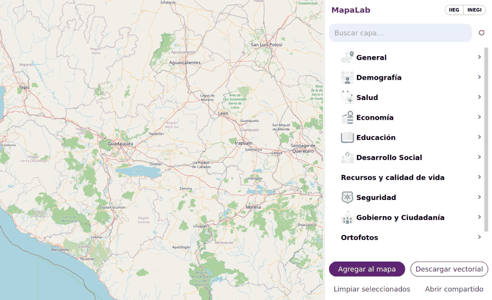
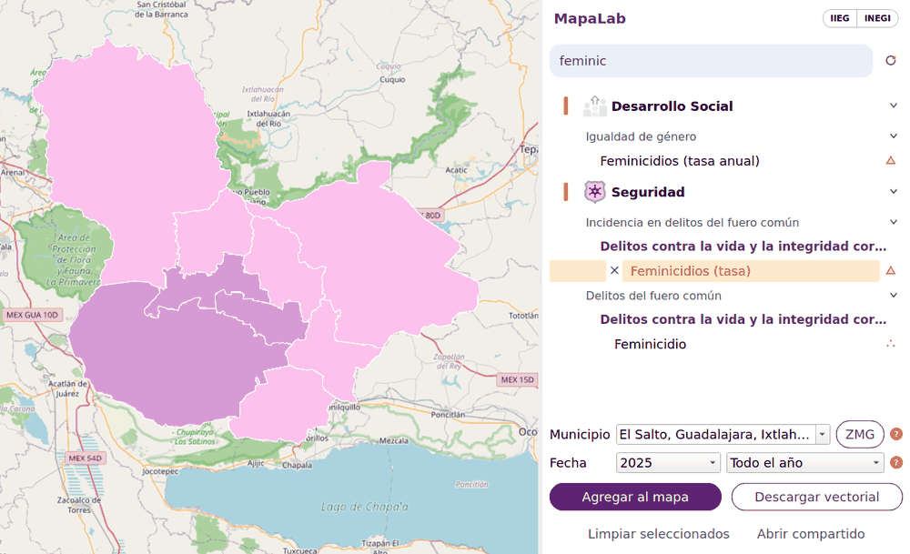
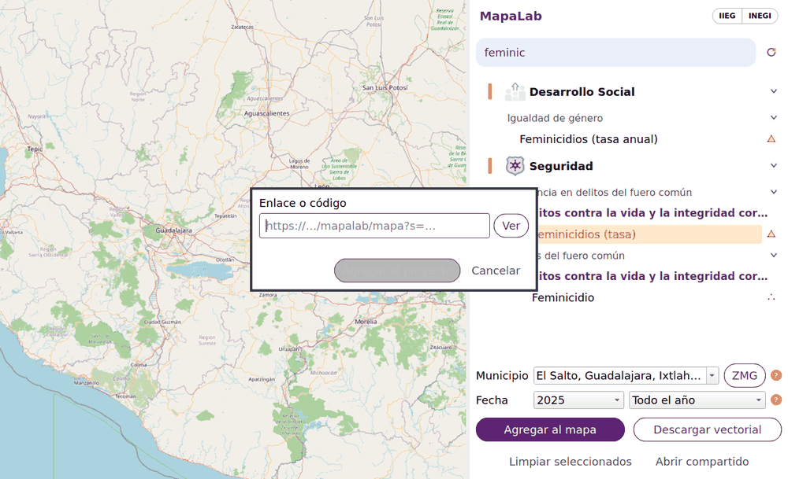

#  MapaLab for QGIS

[](https://qgis.org)
[](LICENSE)

The geospatial layer catalog of the IIEG Jalisco inside QGIS: browse the theme tree, add layers as tiled WMS, filter them by municipality and date, and download them as GeoPackage.



The plugin reads the same catalog as the MapaLab web viewer of the Institute of Statistical and
Geographic Information of Jalisco (IIEG, Mexico) — the same tree, search and institutional metadata —
so a layer published there shows up here without any extra setup. It is read only: it never writes to
the server and needs no account.

## Install

| From | How |
|---|---|
| QGIS plugin manager | Plugins → Manage and Install Plugins → Settings → *Show also experimental plugins*, then search **MapaLab** |
| ZIP | Plugins → Manage and Install Plugins → Install from ZIP, with a `mapalab-qgis-<version>.zip` built by `make zip` |

It comes set to the IIEG server, `https://iieg.jalisco.gob.mx`, and loads the catalog as soon as the
panel opens. Another server (a test or internal one) can be set from Web → MapaLab →
*Cambiar servidor…*.

## Use

The interface is in Spanish, like the catalog.

| To | Do |
|---|---|
| Find a layer | Type in the search box; it ignores accents |
| See a layer | Select it and *Agregar al mapa*, or double click. It loads as tiled WMS with the filter the catalog declares |
| See a whole group | Tick the group's checkbox. Nodes from the same table load as one layer with their filters combined |
| Get the whole table | Right click → *Traer la tabla completa*: skips the catalog filter |
| Analyze the data | *Descargar vectorial* saves a GeoPackage with the current filters. It never overwrites a file: a second download is saved as `_2` |
| Filter by municipality or date | The rows under the tree, when the layer supports them. The date starts on the same period the web viewer shows; changing a filter updates the loaded layer |
| Inspect a feature | With the panel open, click the map. The feature is copied to a *Selección — <layer>* memory layer and its attribute form opens |
| Switch boundaries | The IIEG \| INEGI switch on the panel title: swaps the boundary layers and the geometry everything is drawn with |
| Open a shared map | Web → MapaLab → *Abrir mapa compartido…*, or *Abrir compartido* in the panel |

### Click to inspect



The query goes to the layer selected in the tree, loaded or not; otherwise to the active layer, and
then to the first visible catalog layer that answers, top to bottom. Clicks add up, and clicking a
feature twice does not duplicate it.

### Shared maps



Paste a link from the web viewer (`…/mapalab/mapa?s=<id>`) or just its 10-letter code. The plugin lists
the layers before adding them and then loads them into a *Mapa compartido · <id>* group with their
order, visibility, opacity, filters, municipalities and view. Notes come in as a memory layer, as
plain text. The optional base map is OpenStreetMap.

## Requirements

| Needs | Why |
|---|---|
| QGIS 3.40 LTR or 4.x | Qt 5 and Qt 6 are both supported |
| Network access to the MapaLab server | Every layer, filter and icon comes from it |
| Nothing else | No external Python packages: only `qgis` and the standard library |

All requests go through QGIS' own network manager, so proxy and certificate settings are respected.
Layers are requested as 256 px tiles so they can be cached by the server.

## Development

```bash
make zip      # dist/mapalab-qgis-<version>.zip and a stable dist/mapalab-qgis.zip
make verify   # the zip matches the committed files
make scan     # the security scanners of the QGIS plugin repository, on the zip
make link     # symlink the repository into the default QGIS profile
make tokens   # refresh theme.qss from the identity manual
```

`make scan` runs Bandit and detect-secrets in Docker, the two checks that block a plugin version on
the QGIS plugin repository, plus flake8 as a report.

Changes are listed in [docs/CHANGELOG.md](docs/CHANGELOG.md).

## License

[MIT](LICENSE) © Instituto de Información Estadística y Geográfica de Jalisco
